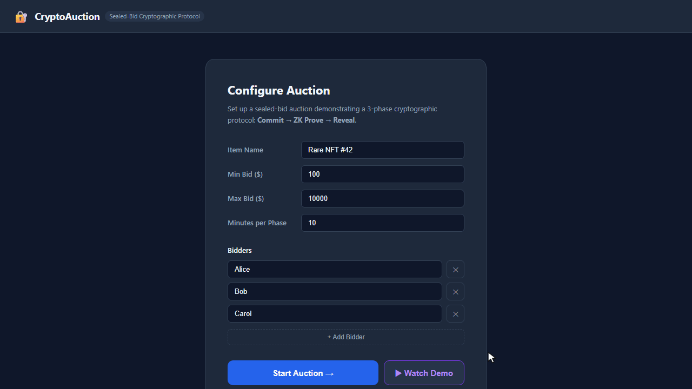

# CryptoAuction

[](https://github.com/erihhh6/crypto-auction/actions/workflows/ci.yml)
[](https://www.python.org/)
[](https://opensource.org/licenses/MIT)

A web application (Flask + vanilla JS) demonstrating a complete 3-phase sealed-bid
auction with applied cryptography: **Commit → ZK Prove → Reveal**.

> Built as a portfolio project to demonstrate applied cryptography concepts,
> using Python's standard library, Flask, and the pure-Python
> [`ecdsa`](https://pypi.org/project/ecdsa/) package for secp256k1 arithmetic.

> [!WARNING]
> **Work in progress.** This started as a prototype and is being hardened step
> by step. Two of its headline guarantees do **not** hold yet: the server sees
> every bid in plaintext, and the range proof can be forged. See
> [Limitations](#limitations) for the current status.

---

## Demo



---

## What This Demonstrates

| Property | Mechanism | Intended guarantee | Status |
|---|---|---|---|
| **Hiding** | SHA-256 commitment `C = SHA256(bid ‖ r)` | Auctioneer cannot learn bids before reveal | **Not yet**: the server receives the bid in plaintext |
| **Binding** | Collision resistance of SHA-256 | Bidders cannot change their bid after committing | Holds |
| **Soundness** | ZK range proof (Sigma + Fiat-Shamir) | Bids provably within `[min, max]` without disclosure | **Not yet**: proofs can be forged |
| **Verifiability** | Commitment opening at reveal | Anyone can audit the final result | Holds: openings are public after the reveal |

---

## Security Model

**Target model, honest-but-curious (semi-honest)**: the auctioneer follows the
protocol but tries to learn bids before the reveal phase. The protocol is
designed so that:

```
Phase 1 — COMMIT:   auctioneer sees only C = SHA256(bid ‖ r)
Phase 2 — ZK PROVE: auctioneer knows bid ∈ [min, max] without seeing bid
Phase 3 — REVEAL:   auctioneer verifies SHA256(bid ‖ r) == C
```

**The current implementation does not meet this model yet.** The browser sends
the bid to the server, which computes the commitment and the proof itself, so
the auctioneer learns every bid in phase 1.

Bidders are also honest-but-curious among themselves — they see each other's
commitments but not the underlying bid values until phase 3.

---

## Protocol

```
PHASE 1 — COMMIT
  Bidder i chooses bid_i and randomness r_i (32 random bytes)
  Computes   C_i = SHA256(bid_i_bytes ‖ r_i)
  Sends C_i → auctioneer stores it (bid_i, r_i remain private)

PHASE 2 — ZK VALIDATE
  Bidder i proves that bid_i ∈ [min_bid, max_bid]
  using a Sigma protocol with Fiat-Shamir transform (NIZK)
  without revealing bid_i
  Auctioneer verifies proof

PHASE 3 — REVEAL
  Bidder i reveals (bid_i, r_i)
  Auctioneer verifies: SHA256(bid_i ‖ r_i) == C_i
  Winner = argmax(verified bid_i)
```

This is the intended protocol. In the current implementation the server
performs the bidder's steps in phases 1 and 2 (see [Limitations](#limitations)).

---

## How to Run

```bash
pip install -r requirements.txt   # installs the crypto_auction package (editable) and Flask
python -m crypto_auction.web
# Open http://localhost:5000
```

For local development with auto-reload and the interactive debugger
(never enable this on a reachable host):

```bash
flask --app crypto_auction.web run --debug
```

Or try the cryptographic building blocks without the web app:

```bash
python examples/commitment_demo.py      # commitment demo
python examples/range_proof_demo.py     # ZK range proof demo
python examples/auction_simulation.py   # full 3-bidder simulation
```

Development setup (tests, coverage, lint, types):

```bash
pip install -r requirements-dev.txt
pytest --cov                # test suite with branch coverage (fails below the floor)
ruff check .                # lint
ruff format --check .       # formatting
python -m mypy              # strict type check of src/ and examples/
node --test "tests/js/*.test.mjs"   # frontend rendering tests (Node 22+, no npm install)
```

Known, not-yet-fixed bugs are recorded as tests that assert the correct
behaviour, marked `@known_bug(...)` (a strict `xfail`, see `tests/support.py`).
They show up as `XFAIL` with their reason; the commit that fixes a bug
removes its marker, and the suite fails if a marker outlives its bug.

---

## Project Structure

```
crypto-auction/
├── .github/
│   └── workflows/
│       └── ci.yml            # GitHub Actions CI
├── docs/
│   └── demo.gif              # Demo GIF (shown in README)
├── examples/                 # Runnable demos of the package, no web app needed
├── src/
│   └── crypto_auction/       # The installable package
│       ├── __init__.py
│       ├── commitment.py     # SHA-256 commitment scheme
│       ├── pedersen.py       # Pedersen commitments on secp256k1 (replacing commitment.py)
│       ├── bit_proof.py      # ZK OR-proof that a Pedersen commitment hides 0 or 1
│       ├── range_proof.py    # ZK range proof by bit decomposition (replacing zkp.py)
│       ├── transcript.py     # Unambiguous encoding for Fiat-Shamir transcripts
│       ├── zkp.py            # Range proof (Sigma + Fiat-Shamir), currently unsound
│       ├── auction.py        # State machine + auction logic
│       ├── service.py        # Runs one auction and the server's protocol steps
│       └── web/              # Flask app: create_app(), python -m crypto_auction.web
│           ├── api.py        # /api blueprint: routes and request validation
│           ├── templates/
│           │   └── index.html  # Single page, 3-panel layout
│           └── static/
│               ├── app.js    # Frontend SPA (vanilla JS)
│               └── style.css # Dark theme CSS
├── tests/
│   ├── js/
│   │   └── render.test.mjs   # Frontend rendering (HTML escaping), via node --test
│   ├── support.py            # Shared helpers (known_bug marker, proof forger)
│   ├── test_commitment.py    # Commitment scheme
│   ├── test_pedersen.py      # Pedersen commitments, generators, encoding
│   ├── test_bit_proof.py     # Bit proof: completeness, soundness, binding
│   ├── test_range_proof.py   # Range proof, incl. wrap-around and non-bit attacks
│   ├── test_zkp.py           # Range proof, incl. soundness
│   ├── test_auction.py       # State machine and winner selection
│   ├── test_api.py           # REST API via Flask's test client
│   └── test_app.py           # Server entry point (debug mode)
├── pyproject.toml            # Package metadata and tool configuration
├── requirements.txt          # Installs the package and its dependencies
└── requirements-dev.txt      # Test, lint and type-check tooling
```

---

## Cryptographic Primitives

| Primitive | Implementation | Purpose |
|---|---|---|
| Commitment | `SHA-256(bid_bytes ‖ randomness)` | Hiding + Binding |
| ZK Range Proof | Sigma protocol + Fiat-Shamir transform | Validity without disclosure (currently unsound, see below) |
| Challenge | `SHA-256(commitment ‖ announcement)` | Non-interactive (NIZK) |
| Reveal | Commitment opening | Auditability |

### Commitment Scheme

```
C = SHA256( struct.pack('>Q', bid) + os.urandom(32) )
```

- **Hiding**: SHA-256 is one-way; C reveals nothing about bid.
- **Binding**: SHA-256 is collision-resistant; bidder cannot find `(bid', r')` with the same C.

### ZK Range Proof

The range `[min, max]` is decomposed into two non-negativity proofs:

- `low_val  = bid - min  ≥ 0`
- `high_val = max - bid  ≥ 0`

Each uses a fresh commitment to the gap value, a Fiat-Shamir challenge
`e = SHA256(C_original ‖ C_gap)`, and a response `z = r_gap + e * r_original`.

The verifier checks:
1. Challenges are correctly re-derived (Fiat-Shamir consistency).
2. Responses are non-negative.

**This construction is not sound.** Nothing links `C_gap` to the committed bid,
and `z` is a sum of non-negative numbers, so check 2 always passes. Anyone can
build an accepted proof from random bytes without knowing the bid (see
`TestSoundness` in `tests/test_zkp.py`). The challenge also omits `min` and
`max`, and the responses leak about half of the bits of `r`. Because SHA-256
commitments have no algebraic structure, this cannot be patched in place; the
plan is to replace it with Pedersen commitments and a bit-decomposition range
proof.

---

## Limitations

- **Bids pass through the server**: the browser sends the bid in plaintext to
  `/api/commit`, and the server computes the commitment and, later, the range
  proof. The auctioneer therefore learns every bid in phase 1. The target
  design computes both in the browser so the server never sees the bid.
- **Unsound range proof**: see [ZK Range Proof](#zk-range-proof) above.
- **No authentication**: any client can act as any bidder or reset the auction.
- **No deadlines**: a bidder who never commits or reveals stalls the auction.
- **Single-server model**: Production would use MPC for the auctioneer role.
- **In-memory state**: No database; a server restart resets the auction.

Known bugs are tracked as `known_bug` tests (see the development setup above);
`pytest -rx` lists them with their reasons.

---

## References

- Commitment Schemes: Goldreich, *Foundations of Cryptography*, Vol. 1
- Sigma Protocols: Cramer, Damgård & Schoenmakers, *Proofs of Partial Knowledge* (1994)
- Fiat-Shamir Transform: Fiat & Shamir, *How to Prove Yourself* (1986)
- Sealed-Bid Auctions: Brandt, *How to Obtain Full Privacy in Auctions* (2006)
